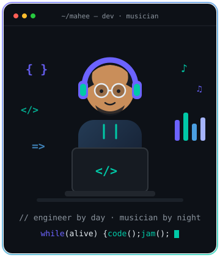

<!-- ═══════════════════════ HEADER ═══════════════════════ -->
<div align="center">
  

  <!-- rotating prompt tagline -->
  

  <br/>

  <!-- terminal-path badges -->
  <a href="https://www.maheenur13.dev">
    
  </a>
  <a href="https://www.maheenur13.dev/workflow">
    
  </a>
  <a href="https://www.linkedin.com/in/differentmahee13/">
    
  </a>
  <a href="https://github.com/maheenur13?tab=followers">
    
  </a>
  

</div>

<br/>

<!-- ═══════════════════════ ABOUT ME ═══════════════════════ -->
## 💻 `$ whoami`



```typescript
// mahee.service.ts — running since 2021, zero downtime ☕

@Injectable({ scope: Scope.DEFAULT }) // always available
export class Mahee extends SoftwareEngineer implements Musician {
  readonly company = "Strativ AB 🇸🇪";
  readonly startup = "Ternion Loop — Founder & CEO 🚀";
  readonly firstProduct = "Sports Loop 🏟️";
  readonly base = "Dhaka, Bangladesh 🇧🇩";
  readonly uptime = "5 years in production";
  readonly motto = "I code everyday! ^_^";

  async currentFocus(): Promise<Focus[]> {
    return [
      "LLM products on Claude 🤖",
      "RAG: chunking, embeddings, pgvector",
      "MCP: connecting AI tools to real data",
      "System design & microservices",
    ];
  }

  @Get("/stack")
  stack(): TechStack {
    return {
      frontend: ["TypeScript", "React", "Next.js"],
      backend: ["Node.js", "NestJS", "PostgreSQL", "Redis"],
      mobile: ["React Native", "Expo"],
      ai: ["Claude", "OpenAI", "Groq", "MCP", "RAG"],
    };
  }

  @Cron("*/60 * * * *") // hourly, non-negotiable
  refuel(): Coffee { return new Coffee({ size: "large" }); }

  @OnEvent("work.done")
  unwind(): Music {
    return this.play("guitar 🎸") ?? this.produce("FL Studio 🎹");
  }
}
```

```console
$ mahee --achievements
  🥇 Employee of the Year, APSIS Solutions (top 1%) · 2023
  🏅 Employee of the Quarter, APSIS Solutions (top 2%) · 2022
  🏆 3rd place, Inter-University Programming Contest (Take Off)
  🧩 250+ problems solved on LeetCode & Beecrowd
  🌐 portfolio → https://www.maheenur13.dev
```

<br clear="right"/>

<!-- ═══════════════════════ EXPERIENCE ═══════════════════════ -->
## 💼 `$ git log --career`

```console
$ git log --career --oneline --graph

* e7d19f3 (feature/startup) Founder & CEO · Ternion Loop 🚀
│          shipping Sports Loop 🏟️ — our first product, live on Google Play
│
* a4f2b1c (HEAD -> main, origin/stockholm) Software Engineer · Strativ AB 🇸🇪
│          Aug 2024 → present
│          · context engine: RAG knowledge base over every project, answers with Claude, now sold to clients
│          · MCP connections between AI tools and internal knowledge bases
│          · Strativ Greenroom: AI interviewer used for candidate screening
│          · Alent Dynamic (industrial IoT for sawmills), Chefry, Biap (App Store)
│
* 9c8e3d2 (dhaka) Software Engineer · APSIS Solutions Ltd 🇧🇩
│          Jun 2022 → Aug 2024
│          · led 8 frontend developers on an ERP for IFIC Bank, BRAC University, Prime Bank
│          · ERP mobile apps (React Native + Expo), Storybook component library as an npm package
│
* 1f0a7e5 (dhaka) Junior Software Engineer · Zaynax Ltd 🇧🇩
           Aug 2021 → Jul 2022 · Next.js component library · e-commerce admin & seller dashboards

$ # 5 years committed, zero force-pushes to production 😌
```

<!-- ═══════════════════════ WORKFLOW ═══════════════════════ -->
## 🧭 `$ cat ~/workflow`

I built **Wayline**, my own app for learning and shipping, on an Android phone and a Windows laptop. Its backend is my portfolio.

```console
$ wayline --how-it-works
  📱 Android (Expo)  ┐
  🖥️  Windows (Electron)├──▶  maheenur13.dev (Next.js + Payload + Postgres)
  🎙️ voice assistant  ┘            │
                                     ├──▶ Groq · Workers AI   (assistant, memory, drafts)
                                     ├──▶ /learning · /notes  (what I'm learning, in public)
                                     └──▶ LinkedIn             (posts, after I approve them)

$ wayline --loop
  plan → focus → practice → review → share   # one app, $0 a month on free tiers
```

<sub>Full diagram and the weekly loop → <a href="https://www.maheenur13.dev/workflow">maheenur13.dev/workflow</a></sub>

<!-- ═══════════════════════ TECH STACK ═══════════════════════ -->
## 🛠️ `$ npx mahee --stack`

<div align="center">

### `~/frontend`


<sub>+ Ant Design • shadcn/ui • Zustand • Redux Toolkit • TanStack Query • Socket.io • Playwright</sub>

### `~/backend`


<sub>+ Microservices • REST • gRPC • WebSocket • Zod • queues & background jobs • Stripe</sub>

### `~/ai-llm` 🤖
     

<sub>knowledge bases • AI interviewer • tool calling • streaming • prompt engineering</sub>

### `~/databases`


<sub>+ Mongoose • NeonDB • SQL</sub>

### `~/mobile-desktop`


<sub>React Native • Expo • EAS builds & OTA updates • Electron</sub>

### `~/devops-tools`


<sub>+ CI/CD • Railway • Sentry • Supabase Edge Functions • Cursor • Claude Code</sub>

</div>

<!-- ═══════════════════════ FEATURED PROJECTS ═══════════════════════ -->
## 🚀 `$ ls ~/projects --featured`

| Project | Description | Tech |
|---------|-------------|------|
| 🧠 **[Strativ Context Engine](https://www.maheenur13.dev/projects/strativ-context-engine)** | AI knowledge base over project data, meeting notes and docs; answers with Claude, reached from AI tools through MCP. Now sold to clients | RAG • pgvector • Claude • MCP |
| 🏟️ **[Sports Loop](https://www.maheenur13.dev/projects/sports-loop)** | Sports community app: matchmaking, chat, venues on a map, live cricket scores. iOS, Android and web from one codebase | Expo • NestJS microservices • PostgreSQL • Redis |
| 📄 **[TernCV](https://terncv.vercel.app)** | Free ATS resume builder in the browser, no account. PDFs carry their data for re-import | React 19 • Vite • @react-pdf • Web Crypto |
| 📝 **[Prompt Grade](https://www.maheenur13.dev/projects/prompt-grade)** | Teachers describe a quiz in plain words; an LLM builds it and grades the answers with feedback | React • Express • MongoDB • Groq |
| ⚙️ **[Alent Dynamic](https://www.maheenur13.dev/projects/alent-dynamic)** | Industrial IoT for Swedish sawmills: monitor and control wood-drying kilns in real time | React • real-time data |
| 🧭 **[Wayline](https://www.maheenur13.dev/workflow)** | My own learning and shipping app: Android + Windows, voice assistant, LinkedIn drafts, on my portfolio's backend | Expo • Electron • Next.js • Payload |

<sub>More case studies → <a href="https://www.maheenur13.dev/#projects">maheenur13.dev/#projects</a></sub>

<!-- ═══════════════════════ GITHUB STATS ═══════════════════════ -->
## 📊 `$ git stats --all-time`

<div align="center">

  
  

  <br/><br/>

  

  <br/><br/>

  

</div>

<!-- ═══════════════════════ TROPHIES ═══════════════════════ -->
## 🏆 `$ gh trophies --unlock-all`

<div align="center">
  
</div>

<!-- ═══════════════════════ SNAKE ═══════════════════════ -->
## 🐍 `$ ./snake --eat contributions`

<div align="center">
  <picture>
    <source media="(prefers-color-scheme: dark)" srcset="https://raw.githubusercontent.com/maheenur13/maheenur13/output/github-contribution-grid-snake-dark.svg"/>
    <source media="(prefers-color-scheme: light)" srcset="https://raw.githubusercontent.com/maheenur13/maheenur13/output/github-contribution-grid-snake.svg"/>
    
  </picture>
</div>

<!-- ═══════════════════════ QUOTE ═══════════════════════ -->
## ✍️ `$ fortune --dev`

<div align="center">
  
</div>

<!-- ═══════════════════════ FOOTER ═══════════════════════ -->
<div align="center">

  ### 🤝 `$ mahee --connect`

  <sub>establishing connection… let's build something great together</sub>
  <br/><br/>

  <a href="https://www.maheenur13.dev">
    
  </a>
  <a href="https://www.linkedin.com/in/differentmahee13/">
    
  </a>

  <br/>

  
</div>
